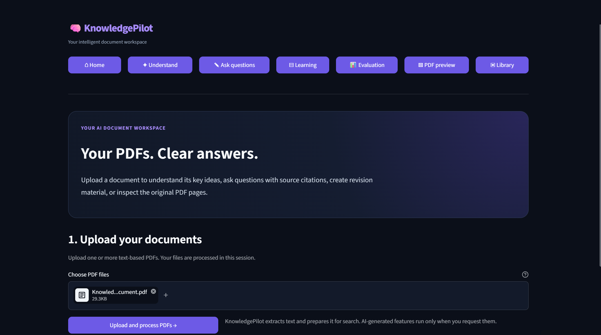
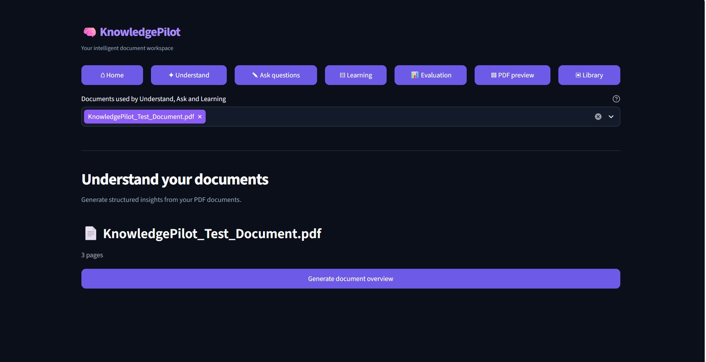
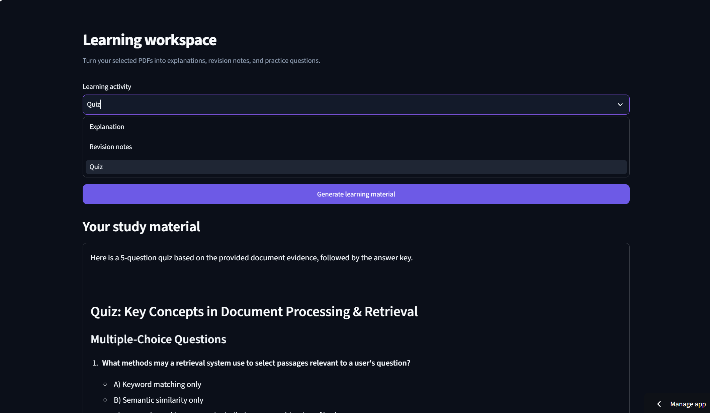
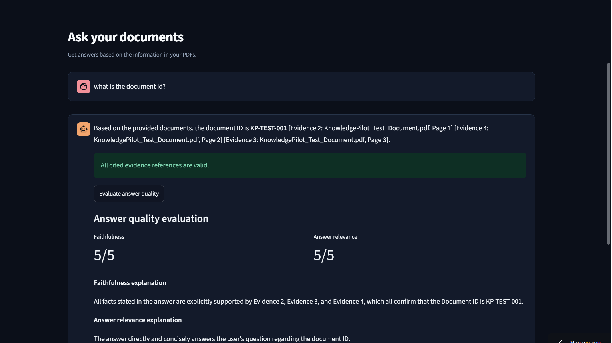
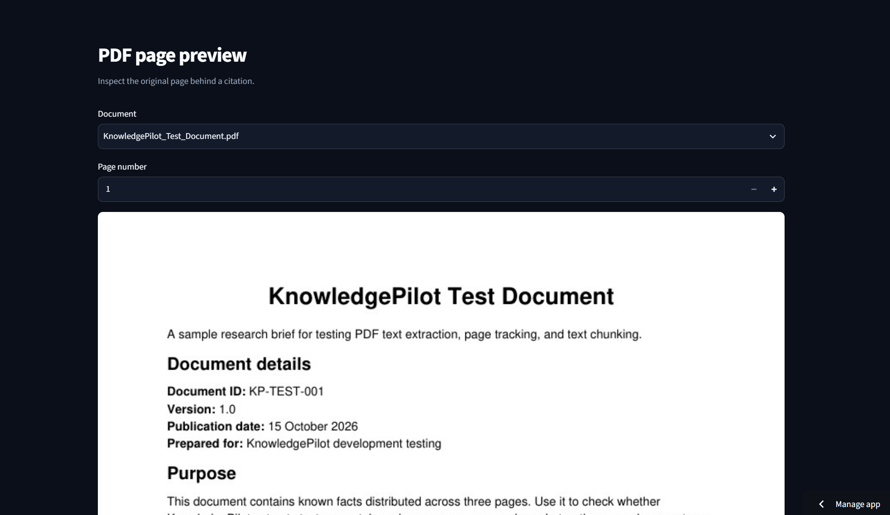

# KnowledgePilot — AI-Powered PDF Research Assistant

KnowledgePilot is an AI-powered PDF research assistant that helps users understand, explore, and ask questions about their PDF documents using Retrieval-Augmented Generation (RAG).

Instead of manually searching through lengthy documents, users can upload PDFs, retrieve relevant information, and receive AI-generated answers grounded in document content.

## Features

- **PDF Processing:** Extracts text and page information from uploaded PDF documents.
- **Text Chunking:** Splits document content into smaller, overlapping chunks for retrieval.
- **Hybrid Retrieval:** Combines semantic search and keyword-based search using Reciprocal Rank Fusion (RRF).
- **AI-Powered Question Answering:** Uses Gemini to generate answers based on retrieved document context.
- **Source Citations:** Provides evidence references with document names and page numbers.
- **Document Understanding:** Generates document overviews and learning material.
- **Retrieval Evaluation:** Compares semantic, keyword, and hybrid retrieval using Hit Rate, Recall, and Mean Reciprocal Rank (MRR).
- **Answer Evaluation:** Evaluates answer faithfulness and relevance and checks citation references.

## Technology Stack

| Component | Technology |
|---|---|
| Programming Language | Python |
| User Interface | Streamlit |
| PDF Processing | PyMuPDF |
| Semantic Embeddings | Sentence Transformers |
| Vector Search | FAISS |
| Keyword Search | Scikit-learn TF-IDF |
| Retrieval Strategy | Reciprocal Rank Fusion |
| Generative AI | Google Gemini API |

## Architecture

1. Upload PDF documents.
2. Extract text and page information.
3. Split extracted text into overlapping chunks.
4. Generate semantic embeddings and build a FAISS index.
5. Create a TF-IDF representation for keyword retrieval.
6. Retrieve relevant chunks using semantic and keyword search.
7. Combine retrieval rankings using Reciprocal Rank Fusion.
8. Pass retrieved evidence to Gemini for answer generation.
9. Display the answer with source references.

## Project Structure

```text
KnowledgePilot/
│
├── .streamlit/
│   └── config.toml
│
├── app.py
├── rag_engine.py
├── retrieval_evaluation.py
├── answer_evaluation.py
├── requirements.txt
├── README.md
├── .gitignore
└── KnowledgePilot_Test_Document.pdf
```

## Installation and Setup

### 1. Clone the repository

```bash
git clone YOUR_GITHUB_REPOSITORY_URL
cd KnowledgePilot
```

### 2. Create a virtual environment

```bash
python -m venv .venv
```

Activate it on Windows:

```powershell
.venv\Scripts\activate
```

### 3. Install dependencies

```bash
pip install -r requirements.txt
```

### 4. Configure the Gemini API key

Create a file named `secrets.toml` inside the `.streamlit` directory.

Add:

```toml
GEMINI_API_KEY = "YOUR_GEMINI_API_KEY"
```

Never publish your actual API key.

### 5. Run the application

```bash
streamlit run app.py
```

## Evaluation

KnowledgePilot includes two evaluation components:

**Retrieval Evaluation**
- Hit Rate@K
- Recall@K
- Mean Reciprocal Rank (MRR)
- Comparison of semantic, keyword, and hybrid retrieval

**Answer Evaluation**
- Faithfulness
- Relevance
- Citation validation
- Identification of unsupported claims

Evaluation results are estimates based on the available test cases and should not be treated as a guarantee of factual correctness.

## Limitations

- Scanned PDFs may require OCR before their text can be extracted.
- Answer quality depends on document quality, retrieval results, and the language model.
- Generated evaluation questions and reference labels may require manual review.
- Citation validation checks references against retrieved evidence but does not independently prove every generated claim.

## Future Improvements

- OCR support for scanned PDFs.
- Improved retrieval and reranking strategies.
- Expanded evaluation datasets.
- Persistent document storage.
- Deployment for public access.

## Live Demo

Try KnowledgePilot: https://knowledgepilot.streamlit.app/

## Screenshots

### Home


### Understanding Documents


### Learning Interface


### Question Answering


### PDF Preview


## Author

Developed as an AI engineering portfolio project to explore Retrieval-Augmented Generation, semantic search, hybrid retrieval, and LLM-based evaluation.
